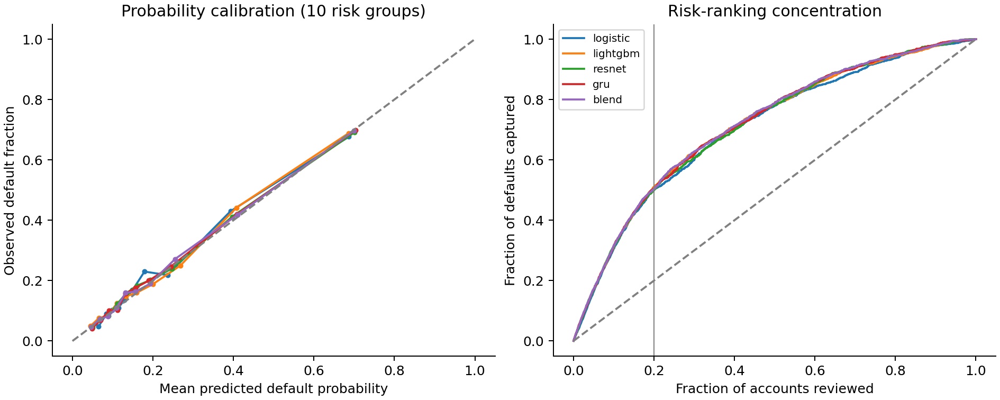

# ClearCredit

**Which credit-card accounts should a risk analyst review first?**

This project predicts next-month default from customers' recent repayment histories. I compare simpler statistical models with deep learning, then examine whether their risk estimates are reliable and which defaults they miss.

On 6,000 historical accounts, the selected neural model placed **50.6% of eventual defaults in the highest-risk 20% of accounts**. That is useful risk concentration, but it did **not clearly outperform LightGBM**. The more revealing result is where the model fails: it recognises existing repayment distress much better than it warns of distress before that signal appears.

[**Results and failure analysis**](research/v2/RESEARCH_REVIEW.md) · [**Code and reproduction**](research/v2/) · [**Model card**](research/v2/MODEL_CARD.md)

## What I built

- A comparison of logistic regression, boosted trees, a residual neural network and a **GRU that reads six months of repayment history in order**.
- Separate data for fitting, model selection and probability calibration, with identical financial profiles kept out of different partitions.
- Analysis of default capture at a fixed review workload, probability accuracy, subgroup errors and sensitivity to missing account history.
- A literature review connecting model choices to credit-risk research and model-validation practice.

## Results in context

The UCI dataset contains 30,000 existing Taiwan credit-card accounts. The reporting sample contains **6,000 accounts and 1,327 observed defaults**. Each model below ranks the same number of accounts (1,200) as its highest-risk 20%; the selected accounts can differ between models.

| Model | ROC-AUC | Defaults in highest-risk 20% |
|---|---:|---:|
| Logistic regression | 0.765 | 50.0% |
| LightGBM | 0.775 | 51.1% |
| **Monthly GRU, selected on development data** | **0.777** | **50.6%** |
| Fixed tree/GRU blend, comparison model | 0.779 | 50.4% |

**How to read this:** the GRU's review group contains 671 of the 1,327 defaults, about 2.53 times the concentration expected from random selection. It still leaves 656 defaults outside that group. ROC-AUC measures risk ranking across thresholds; it is not the percentage of accounts classified correctly.

The GRU's AUC advantage over LightGBM is small and its paired confidence interval includes zero. The blend was not promoted after seeing its reporting result: selection had already favoured the GRU on development data. The residual-network result and full-precision tables are in [the saved results](research/v2/results/results.json).

The reporting sample was already examined in the earlier study, so this is **internal retrospective evaluation**, not a fresh or prospective test.

## What the analysis uncovered

- **Limited early warning.** At the fixed development review threshold, the GRU misses 85.2% of defaults among accounts without a latest-month delay code of at least 1.
- **Dependence on recent data.** Masking the latest month's history changes 18.05% of review flags. An imputed score should not be assumed equally reliable.
- **Uneven probability accuracy.** Portfolio-wide predictions are reasonably close to observed default rates, while some age groups are underpredicted.

Sex, age, education, marriage and account ID are excluded from the new model. Demographic audits are descriptive; exclusion alone does not establish fairness. No lending intervention, realised savings or credit-loss reduction is claimed.



## Run the current research study

Python 3.12 was used. From the repository root:

```bash
cd research/v2
python -m pip install torch --index-url https://download.pytorch.org/whl/cpu
python -m pip install -r requirements.txt
python experiment.py --data data/source.xls --out results_reproduced
python -m pytest -q tests
python verify_results.py --data data/source.xls --results results_reproduced
```

The experiment downloads the public UCI workbook if absent, checks its checksum and generates models, predictions and diagnostics. Saved summary metrics, tuning records, protocols and charts are included. Downloaded data and fitted binary artifacts are generated locally. See [the detailed run guide](research/v2/README.md).

## Earlier workflow and SQL extension

The root `src/clearcredit` CLI and API belong to the earlier tabular workflow. Its [saved LightGBM results](reports/uci/metrics.json) remain available as historical evidence. A subsequent schema fix excludes UCI demographic fields and enables their audits; rerunning that corrected code is not an exact replay of the old saved benchmark. [Earlier methodology and version notes](docs/METHODOLOGY.md).

The [Home Credit SQL extension](sql/aggregate_features.sql) aggregates applicant histories in DuckDB. Its joins have synthetic tests, but the full Home Credit model has **not been benchmarked**. None of the UCI results measures that extension or the root API's production readiness.

**Author:** Fakhruddin Hakim Hussain · [Portfolio](https://github.com/Fakhruddin12)
