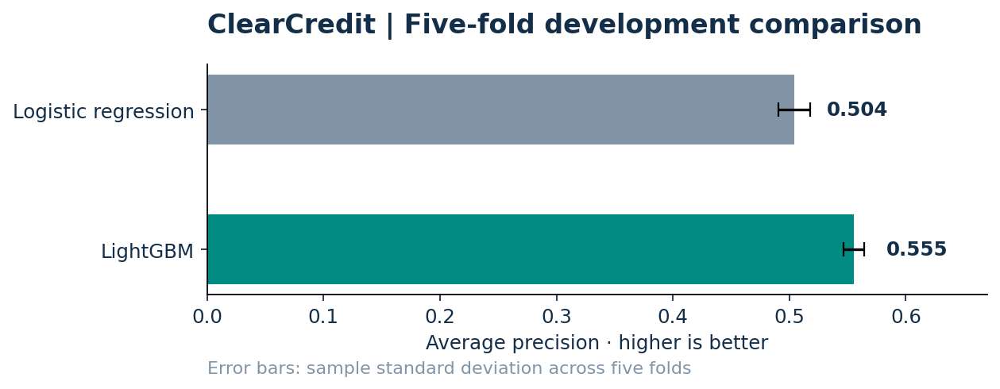

# ClearCredit
### Credit-default modelling, calibration and decision thresholds

**Question:** Can a boosted-tree model improve default-risk ranking over logistic regression, and how does probability calibration affect a stated decision-cost scenario?

**Finding:** LightGBM was selected using five-fold development-set average precision. After calibration, it achieved **0.547 average precision**, **0.774 ROC-AUC** and **0.136 Brier score** on the separate holdout.



| Development comparison | Logistic regression | LightGBM |
|---|---:|---:|
| Mean five-fold average precision | 0.504 | **0.555** |
| Fold standard deviation | 0.014 | 0.009 |
| Mean five-fold ROC-AUC | 0.726 | **0.780** |

[**Inspect the held-out results**](reports/uci/metrics.json) · [**Model card**](reports/uci/model_card.json) · [**Methods and limitations**](docs/METHODOLOGY.md)

## From data to decisions

1. Download and validate **30,000 historical UCI credit-card cases**.
2. Fit preprocessing inside cross-validation and compare logistic regression with LightGBM.
3. Calibrate probabilities and choose a threshold using development predictions.
4. Evaluate once on the reserved 20% holdout; inspect ranking, calibration and decision trade-offs.
5. Expose the fitted model through a local scoring API demonstration.

The metric called `pr_auc` in the saved code is **average precision**, computed with scikit-learn; it is not trapezoidal area under an interpolated PR curve. At the scenario-selected threshold, holdout precision was 0.371 and recall 0.744. The assumed false-approval:false-decline cost ratio is **5:1**, not a measured lender cost.

## Run the measured benchmark

Python 3.10+; run from the repository root.

```bash
python -m pip install -e ".[dev,api]"
python -m clearcredit.cli prepare --config configs/uci.yaml
python -m clearcredit.cli train --config configs/uci.yaml
python -m clearcredit.cli report --config configs/uci.yaml
python -m pytest -q
```

After fitting: `uvicorn clearcredit.api:app --host 127.0.0.1 --port 8000`.

## Separate SQL extension

[sql/aggregate_features.sql](sql/aggregate_features.sql) builds applicant-level historical features in DuckDB from Home Credit application, bureau and prior-application tables. Its joins and date filtering have synthetic contract tests. The full Home Credit model has **not been benchmarked**; the UCI results above do not measure this extension. See [how to supply the competition files](docs/METHODOLOGY.md#home-credit-sql-extension).

## Explore the repository

| Location | Purpose |
|---|---|
| [src/clearcredit](src/clearcredit/) | Data validation, features, modelling, calibration, metrics and API |
| [reports/uci](reports/uci/) | Saved metrics, EDA, importance and model card |
| [sql](sql/) | Multi-table feature aggregation |
| [tests](tests/) | Data integrity, as-of filtering, evaluation and API checks |

The dataset describes Taiwan credit-card clients in a historical sample. A random stratified split does not establish temporal robustness, fairness, or suitability for current lending decisions. This is a research demonstration.

**Author:** Fakhruddin Hakim Hussain · [Portfolio](https://github.com/Fakhruddin12)
