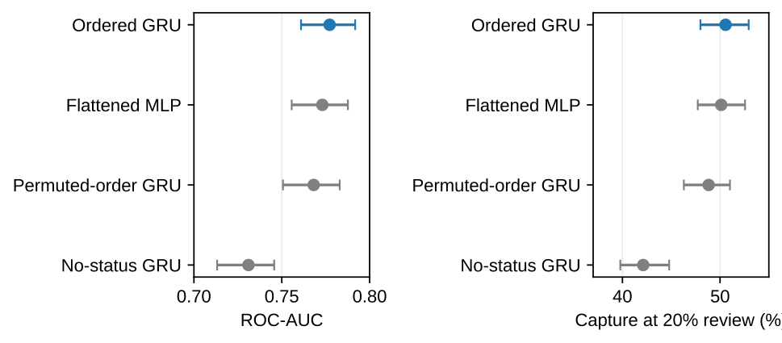

# ClearCredit: post-review history and model challenge

Study date: 31 October 2026. Status: exploratory retrospective follow-up to v2.

## Results at a common workload

The reused reporting sample contains 6,000 accounts and 1,327 defaults. Every row below reviews exactly 1,200 accounts. Neural results use the original three-seed ensemble; additional seeds are sensitivity checks.

| Approach | AUC | Defaults captured | Capture rate |
|---|---:|---:|---:|
| Binary latest-delay rule | 0.678 | 593 | 44.69% |
| Latest-delay severity rule | 0.691 | 616 | 46.42% |
| Latest-month LightGBM | 0.759 | 637 | 48.00% |
| **Full-history LightGBM** | **0.775** | **678** | **51.09%** |
| Ordered GRU | 0.777 | 671 | 50.57% |
| Same monthly inputs, flattened MLP | 0.773 | 665 | 50.11% |
| Independently permuted monthly order, GRU | 0.768 | 648 | 48.83% |
| Repayment-status channels removed, GRU | 0.731 | 559 | 42.13% |

Rules use a fixed, label-independent tie key. Uniform tie handling gives expected capture of 45.08% for the binary rule and 46.73% for severity. Tie sensitivity and the complete eleven-approach comparison are in [saved results](results/results.json).

The full-history tree's capture advantage over the latest-month tree is **3.09 percentage points**, with a paired 95% cluster-bootstrap interval of **1.27–4.63 points**. The ordered versus permuted GRU contrast is **1.73 points**, interval **0.61–3.07**. These are conditional exploratory intervals; the reporting cohort was already examined and no multiplicity adjustment is claimed.



## What changed after challenging the original study

- Added simple status rules and latest-month controls at exactly the same review capacity.
- Compared ordered, flattened, permuted-order and no-status neural representations under a fixed training budget.
- Reported five-seed sensitivity separately from fitted-model bootstrap uncertainty.
- Corrected an early-warning overstatement: low recall under a global threshold does not establish an inability to rank accounts within a lower-risk subgroup.
- Made an explicit research recommendation: advance full-history LightGBM for independent validation under this review objective. The original development-selected GRU is preserved, not retrospectively renamed.

Among accounts without a latest recorded delay, a separately allocated highest-risk fifth captures **37.63%** of defaults with the GRU and **37.93%** with LightGBM. This group can contain earlier delays. It is not a verified first-deterioration cohort, and the dedicated subgroup queue is a different allocation policy from the global queue.

## Evidence and limits

The source is one historical 2005 cohort, not new applicants or a modern prospective portfolio. Financial-input groups are separated across fitting, tuning, calibration and reporting partitions. New latest-month searches use development labels only. Follow-up neural controls inherit the original GRU budget rather than receiving independent exhaustive tuning.

The reporting cohort was used in earlier research. These results remain **exploratory retrospective evaluation**, not fresh out-of-time validation. No lending intervention, financial savings, production readiness or credit-loss reduction is claimed. [The next independent study is specified but has not been run.](NEXT_STUDY_PROTOCOL.md)

## Reproduce

Python 3.12 and a CPU are sufficient. From the repository root:

```bash
python -m pip install torch==2.14.1 --index-url https://download.pytorch.org/whl/cpu
python -m pip install -r research/v3/requirements.txt
cd research/v3
python challenge.py --data ../v2/data/source.xls --out results_reproduced
python -m pytest -q tests ../v2/tests
python verify_challenge.py --data ../v2/data/source.xls --results results_reproduced
```

If original fitted artifacts are absent, the runner first reproduces v2 and downloads the checksum-verified UCI workbook. The follow-up itself completed in about 123 seconds using restored baseline artifacts in the recorded environment; a clean run also incurs baseline fitting. Runtime varies by environment.

Sixteen numerical/data-handling tests pass. The restore verifier checks all eleven score vectors for 6,000 accounts and recomputes aggregate and subgroup metrics. Model weights, source data and per-account predictions are generated locally and excluded from Git.


## Files and provenance

- `challenge.py`: frozen protocol, checksum/split checks, latest-month fitting, representation ablations, five-seed sensitivity, matched-capacity comparisons, paired uncertainty, subgroup analysis and latency.
- `tests/test_challenge.py`: nine new meaningful data-handling/metric checks, alongside seven v2 tests.
- `verify_challenge.py`: restores every fitted candidate and checks all score vectors and aggregate/subgroup metrics.
- `results/`: aggregate metrics, protocol, source/split manifests, environment, development search, preserved selection and neural training losses.
- `MODEL_CARD.md`: scope, choice and limitations.
- `NEXT_STUDY_PROTOCOL.md`: a specified independent later-data study, not completed validation.
- `ClearCredit_Project_Report.pdf`: plain report using the reference layout.

Primary ensembles remain seeds 42/137/2026. Extra seeds 718/9001 are sensitivity checks, not an expanded or selected ensemble. Monthly permutation seed 7331 is fixed independently within each account; aligned channels move together during fitting, calibration and reporting. The flattened network has 4,417 parameters per fit versus 4,473 for the GRU. The no-status GRU has 3,537.

The original study was inspected before this follow-up was designed. Positive secondary intervals are not confirmatory significance tests. Current v3 inference measurements exclude calibration equally for all models and are CPU batch timings, not service benchmarks. The GRU was faster than LightGBM in the measured batch; no generic neural-latency penalty is claimed.
